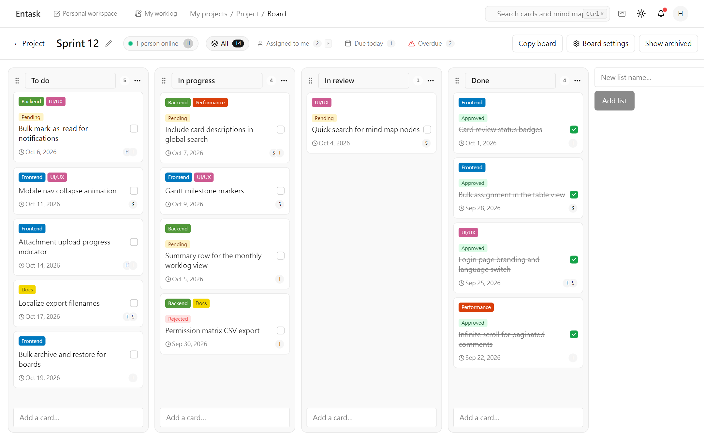
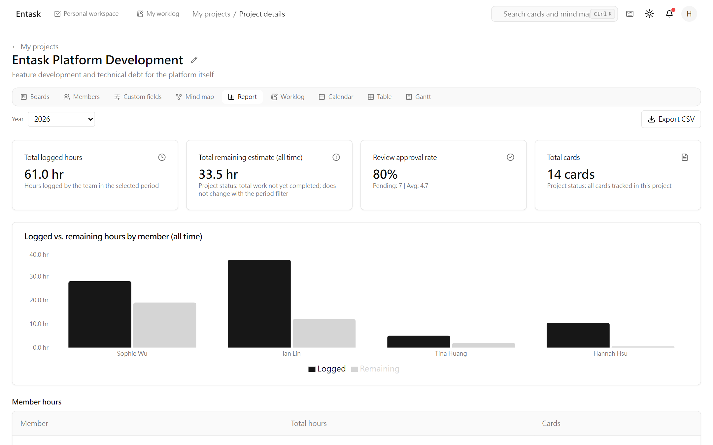
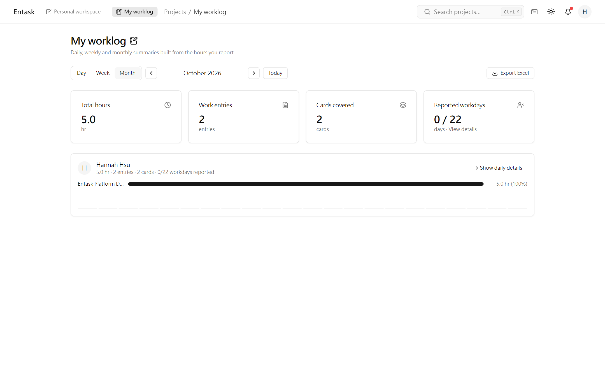
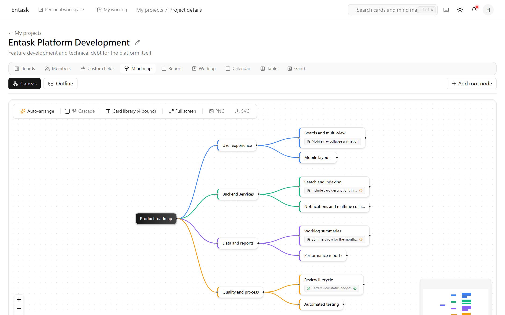
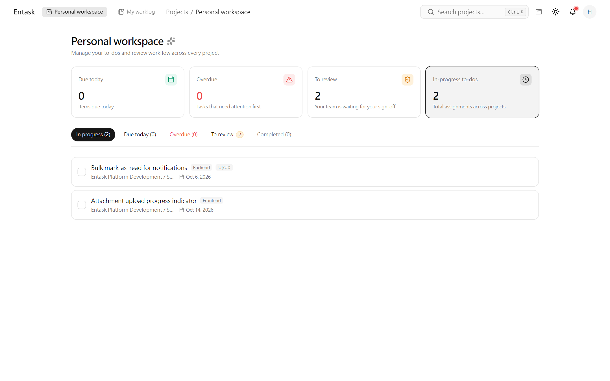

**English** · [繁體中文](README.zh-TW.md)

<div align="center">


# Entask

Self-hosted project management built around one workflow: Create → Assign → Plan → Work → Report
→ Complete → Review. A .NET 10 backend, a React 19 SPA, and PostgreSQL.

[](LICENSE)


</div>

[Quick start](#quick-start) · [Who it is for](#who-it-is-for) · [Features](#features) · [Documentation](#documentation) · [License](#license)



## What it is

A modular monolith: one solution, seven backend projects, and the rule that `Entask.Core`
references nothing else.

<details>
<summary>Modules</summary>

- **`src/Entask.Api`** — endpoints, DTOs and authorization (`RequireProjectPermission` with an
  `IProjectScopeResolver`).
- **`src/Entask.Core`** — entities and abstractions. No project references, and it must not
  reference Identity.
- **`src/Entask.Identity`** — JWT and RBAC.
- **`src/Entask.Infrastructure`** — EF Core, PostgreSQL, seed.
- **`src/Entask.Board`** — the board domain: positioning (base62 ordering), copying, custom fields.
- **`src/Entask.MindMap`** — the mind-map tree.
- **`src/Entask.Performance`** — project reports, worklogs and the work calendar.
- **`web/`** — the SPA: React 19, Vite, TypeScript, TanStack Query v5, zustand (auth only),
  shadcn/ui, @dnd-kit, and real-time collaboration over SignalR.

</details>

<a id="who-it-is-for"></a>

## Who it is for

Entask is built around two routes through the same board.

### Project managers



The project page brings five views together: boards, a calendar, a Gantt chart, a bulk-editable
table, and a mind map. The map's nodes bind to the same cards and show each card's completion
state without opening it. The map and the board read the same cards.

Next to those sits a project report: three objective numbers and one separate layer of review
scores. You use them to see how delivery is going, spot problems, and decide what to change.
First-pass yield is the share of the year's deliveries that passed review the first time, and
the grade comes from completion rate, on-time rate and that yield. Review scores sit in a
separate layer and can move the grade by up to one level; they never change the three numbers.
The team performance report applies the same measures per member: each member's figures open the
exact cards or review entries behind them, and the dossier spells out how the grade was reached.
Worklog coverage is a number too: a completed card with no hours logged shows up as an unreported workday
you can open and chase. When a project is worth reusing, copy it whole. Cards, lists, boards and
whole projects can each be copied on their own.

### Engineers and admin staff



`Personal workspace` is the only list you have to check.

Report your hours on the card you are already working on — **that is the worklog**. The daily,
weekly and monthly reports are computed from those entries, so there is no second timesheet to
keep and no Friday afternoon spent reconstructing the week. The work calendar is
the team's own: Monday to Friday, plus date exceptions you set — a make-up workday or a company
holiday is a row in your calendar, not something the product guesses.

The board works on a phone: a long press starts a drag, a list's grip handle drags immediately,
and the installed PWA keeps you signed in. Commenting does not require edit rights — a separate
`card.comment` permission lets test engineers and admin staff take part without being able to
change the card.

<a id="quick-start"></a>

## Quick start

From a checkout of this repository, with Docker installed:

```bash
cp .env.example .env      # then edit the three required values
docker compose up -d --build
curl http://localhost:8080/api/health
```

That is the whole stack: PostgreSQL 18 and the application, two containers, one command. Open
`http://localhost:8080` and log in with the admin account from your `.env`. The first build takes
minutes, not seconds. To confirm it is actually up, call `/api/health` and check the response.

**Development default credentials.** The demo and seed tooling under `web/` and the login page's
demo-account quick-fill button assume the development default `admin` / `Entask@Dev2026`. That
pair is public on purpose — a development convenience, not a secret — so treat it as local-only.
Any instance other people can reach must set its own credentials: the compose stack requires
`ADMIN_PASSWORD` in `.env` (it refuses to start when the value is empty), and the seed scripts
accept `ENTASK_DEMO_PASSWORD` to override the default.

**The compose stack: trial-grade, not production-grade.** It speaks plain HTTP with no TLS, so
unless you put your own TLS terminator in front, do not send it traffic that crosses a network you
do not control. Backups, monitoring, alerting, high availability and secret management are all yours to add —
the stack ships with a single gitignored `.env`. It exists so you can evaluate Entask, demo it,
or run it for a small trusted group. Section 1 of [docs/SELF-HOSTING.md](docs/SELF-HOSTING.md)
is the explicit list of what it does not provide, and the
same document is the full runbook: the three values, backups, upgrades, your own reverse proxy,
troubleshooting, and your obligations under the license.

<a id="features"></a>

## Features

This is a summary. The recent-feature list is in [docs/features.md](docs/features.md).

- **Checklists** — per-item CRUD: rename in place (Enter, Escape, or blur to save), reorder with
  base62 `between` positioning, delete behind a shared confirmation dialog.
- **Calendar** — a day holding more than three cards opens the rest in a popover; clicking one
  opens the card dialog, and the semantic completion / overdue colours are preserved.
- **Board copy** — the copy action asks for confirmation and spells out what comes with it (lists,
  cards, labels, custom-field values) and that the copy has to be deleted on its own.
- **Custom fields** — creating and editing are separate flows; changing a type warns that existing
  values will be cleared; drop-down options are chip input that accepts Enter, a comma, or a pasted
  list.
- **Mind map** — canvas nodes and outline rows carry the bound card's completion state, in the app
  and in SVG/PNG exports alike.

  

- **Worklogs** — daily, weekly and monthly reports on the personal, project and team pages,
  grouped by local day on the backend using the holidays and make-up workdays your team has set,
  each with a SpreadsheetML
  `.xls` export; a KPI card opens the detail of missing reports.
- **Reviews** — reviewer assignment from the card dialog, with an "assign to me" shortcut and a
  reviewer-count badge; submitting a review asks for confirmation first, and the score is picked
  from a dropdown.
- **Start date and Gantt** — `Card.StartAt` with a date picker. The Gantt chart draws the real
  span; with no start date it marks the due date as a single day.
- **Comments** — their own tab with infinite scroll, cursor pagination for activity, and a
  `card.comment` permission that lets roles without `card.edit` comment.
- **PWA and mobile** — an installable app with a scoped manifest, cache headers that stop the
  installed app from sticking to an old build, and credentials that persist between launches.
  On a touch screen a drag starts on a long press (250 ms) and a 5 px move counts as a scroll, so
  flicking the board no longer lifts a card by accident; a list's grip handle drags immediately
  instead of waiting, its hit area is 40×48, and the column and the handle light up while it is
  held.
- **Admin** — an admin-only system activity page covering user lifecycle events; resetting
  someone's password also unlocks their account. Card activity, comments and the system activity
  log all page in batches with a cursor ("load more").
- **Six locales** — English, Traditional Chinese, Simplified Chinese, Japanese, Korean and Latin
  American Spanish; every UI string ships in all six.



<a id="documentation"></a>

## Documentation

<details>
<summary>Document list</summary>

- [docs/SELF-HOSTING.md](docs/SELF-HOSTING.md) — the Docker Compose runbook: requirements, the
  three values, backups, upgrades, TLS in front, troubleshooting, license obligations.
- [docs/features.md](docs/features.md) — the recent-feature list.
- [docs/DEPLOY.md](docs/DEPLOY.md) — the older on-prem / IIS deployment notes (an alternative to
  the compose stack; not recently verified).
- [docs/REBRANDING.md](docs/REBRANDING.md) — the white-label guide: the display identity you may
  change versus the runtime identity you must not, each row with its failure mode.
- [CHANGELOG.md](CHANGELOG.md) — notable changes, by release.
- [CONTRIBUTING.md](CONTRIBUTING.md) — what feedback is welcome and how to send it.
- [SECURITY.md](SECURITY.md) — how to report a security vulnerability.
- [SUPPORT.md](SUPPORT.md) — how to get support.
- [docs/licensing.md](docs/licensing.md) — license scope and third-party components.

</details>

## Development

<details>
<summary>Build and test commands</summary>

- **Backend** — `dotnet test` with `ENTASK_TEST_CONNECTION` pointing at a PostgreSQL test database
  (the suite recreates its own schema). Build with the CLI: Visual Studio 2022 cannot compile
  .NET 10 projects.
- **Frontend** — `cd web && npx vitest run` for tests, `cd web && npx tsc -b` for types
  (`tsc --noEmit` compiles nothing in this solution layout and always exits 0), `npm run build` for
  the production bundle.

</details>

## Supporting This Project

If you find Entask useful, consider supporting its development. Your support helps me maintain
the project, improve existing features, and build new ones.

[](https://buymeacoffee.com/zebrodev)
[](https://ko-fi.com/zebrodev)

<a id="license"></a>

## License

Copyright (c) 2026 ZebroDev.

ZebroDev is the project's brand name, not a company.

GNU Affero General Public License version 3.0 only (AGPL-3.0-only); the full text is in [LICENSE](LICENSE).

**Self-hosting an unmodified copy?** You have no additional obligation: the source link the
application shows points at the upstream project, which is the code you are running.

**Modifying it and hosting the modified copy?** Renaming it, white-labelling it, changing its
behaviour — [docs/REBRANDING.md](docs/REBRANDING.md) section 1 is the list of what may be changed.
Then AGPL-3.0-only §13 applies to you: you must prominently offer everyone who uses your instance over a
network an opportunity to receive the Corresponding Source **of your version**. Concretely, point
`SOURCE_URL` in `web/src/lib/source-offer.ts` at your own source and rebuild. Nothing checks this
automatically and no test turns red if you forget — [docs/SELF-HOSTING.md](docs/SELF-HOSTING.md)
section 9 states the same obligation with the self-hosting steps next to it.

**How the project is run.** Entask is AGPL-3.0-only, and self-hosting it is one `docker compose
up`. It does not accept external code contributions ([CONTRIBUTING.md](CONTRIBUTING.md)), which
is why there is no CLA.

**Documents and licensing.** Every document in this README's document list ships in English and
Traditional Chinese. [LICENSE](LICENSE) is the full AGPL-3.0-only text, and
[THIRD-PARTY-NOTICES.md](THIRD-PARTY-NOTICES.md) lists the third-party components this project
distributes and their licenses.
