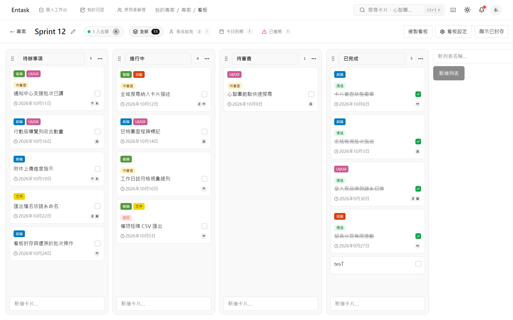
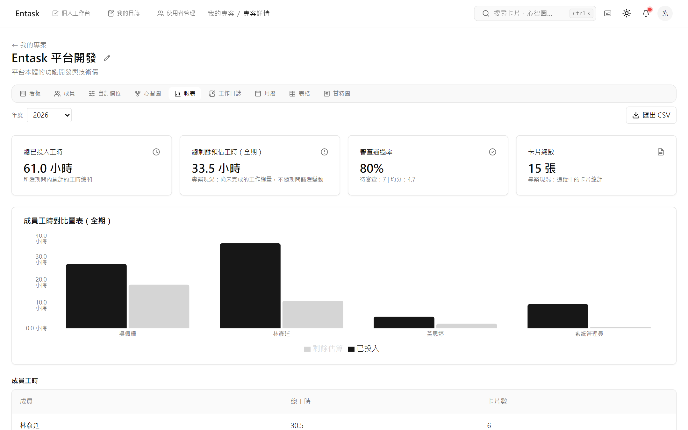
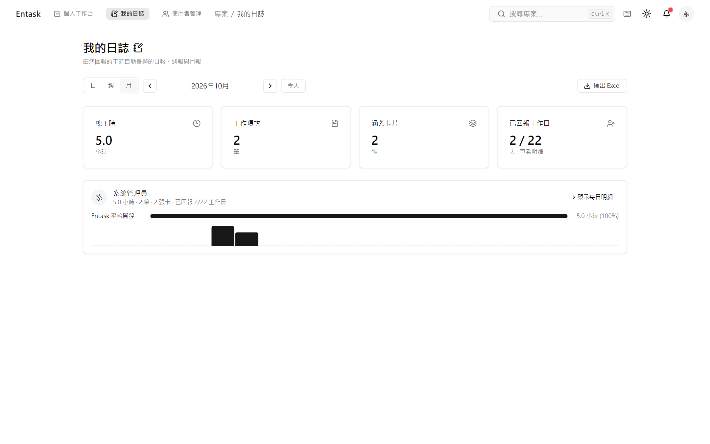
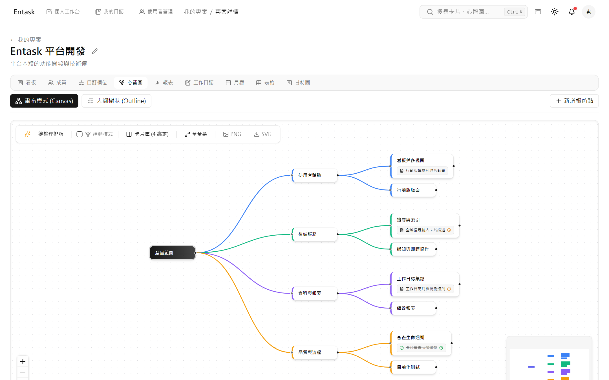
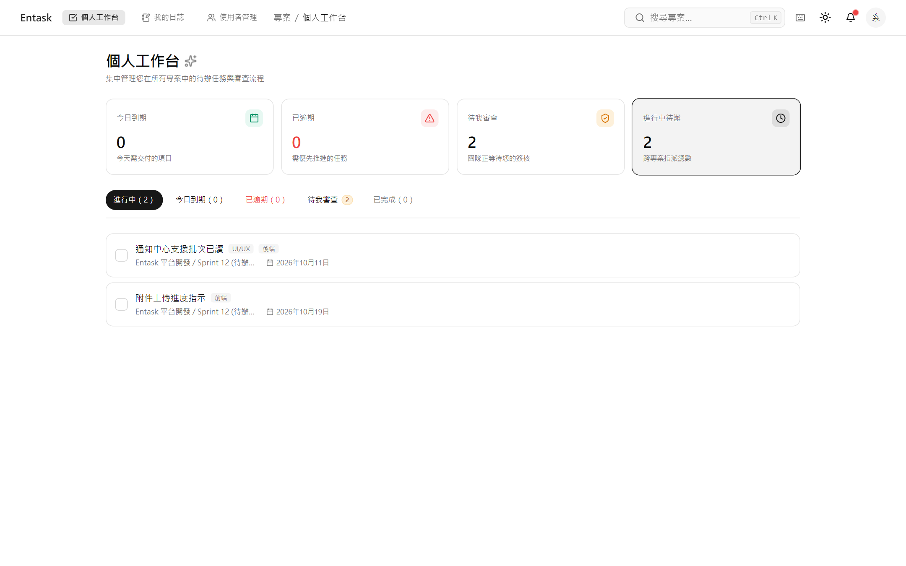

[English](README.md) · **繁體中文**

<div align="center">


# Entask

自架專案管理系統，圍繞一條工作流：建立 → 指派 → 規劃 → 執行 → 回報 → 完成 → 審查。.NET 10 後端、React 19 SPA，以及 PostgreSQL。

[](LICENSE)


</div>

[快速開始](#quick-start) · [這給誰用](#who-it-is-for) · [功能](#features) · [專案文件](#documentation) · [License](#license)



## 專案概況

模組化單體：一個方案、七個後端專案，以及一條規則——`Entask.Core` 不引用任何其他專案。

<details>
<summary>模組</summary>

- **`src/Entask.Api`** — 端點、DTO 與授權（`RequireProjectPermission` 搭配
  `IProjectScopeResolver`）。
- **`src/Entask.Core`** — 實體與抽象。零專案引用，且不可引用 Identity。
- **`src/Entask.Identity`** — JWT 與 RBAC。
- **`src/Entask.Infrastructure`** — EF Core、PostgreSQL、seed。
- **`src/Entask.Board`** — 看板領域：定位排序（base62）、複製、自訂欄位。
- **`src/Entask.MindMap`** — 心智圖樹狀結構。
- **`src/Entask.Performance`** — 專案報表、工作日誌與工作日曆。
- **`web/`** — SPA：React 19、Vite、TypeScript、TanStack Query v5、zustand（僅 auth）、shadcn/ui、@dnd-kit，以及走 SignalR 的即時協作。

</details>

<a id="who-it-is-for"></a>

## 這給誰用

Entask 圍繞著同一塊看板上的兩條動線。

### 專案經理



專案頁把五個視圖放在一起：看板、月曆、甘特圖、可批次編輯的表格，以及心智圖。心智圖的節點綁定同一批卡片，每個節點直接顯示那張卡片完成了沒，不必點開。心智圖與看板看的是同一批卡片。

旁邊是專案報表：三個客觀數字，加上一層獨立的主觀評分。它的數字用來檢視交付、找出問題，以及討論下一步。一次交付通過率＝這一年交付的東西裡有多少第一次審查就過；評級由達成率、準時交付率與通過率決定。審查評分是獨立的一層，最多把評級往上或往下調一級，不會動到那三個數字。團隊績效報表把同一組指標套用到每位成員：每個成員的數字都能點開背後的卡片或 review 明細，考核表也會說明評級是怎麼來的。工作日誌的覆蓋率也是一個數字：一張完成了卻沒人回報工時的卡片，會變成一筆你可以點開、可以追的未回報工作日。專案值得沿用時就整個複製。卡片、清單、看板、整個專案，都可以單獨複製。

### 工程師與行政人員



`個人工作台` 是你唯一要盯的清單。

工時直接報在你正在處理的那張卡片上，**那就是工作日誌**。日報、週報、月報都從這些紀錄算出來，不必再維護第二份工時表，週五下午也不必回頭拼湊這一週。工作日曆是每個團隊自己的：週一到週五，再加上你設的逐日期例外——補班日或公司假日是你日曆上的一列，不是產品替你猜的。

看板在手機上能用：長按才會開始拖曳，清單的握把立即拖曳，裝成 PWA 之後保持登入。留言不需要編輯權——獨立的 `card.comment` 權限讓測試工程師與行政人員參與討論，卻動不了卡片本身。

<a id="quick-start"></a>

## 快速開始

取得本 repo 的 checkout、裝好 Docker 之後：

```bash
cp .env.example .env      # then edit the three required values
docker compose up -d --build
curl http://localhost:8080/api/health
```

整套就是這樣：PostgreSQL 18 加應用程式，兩個容器、一行指令。打開 `http://localhost:8080`，用你 `.env` 裡的管理員帳號登入。第一次建置是分鐘級、不是秒級。要確認服務真的起來了，對 `/api/health` 發一次請求、看回應就知道。

**開發預設帳密。** `web/` 底下的示範與 seed 工具，以及登入頁的示範帳號快速填入按鈕，都假設開發預設是 `admin` / `Entask@Dev2026`。這一組是刻意公開的——開發上的方便，不是機密——所以只把它當本機用途。任何別人連得到的實例都必須設定自己的帳密：compose 堆疊要求 `.env` 裡有
`ADMIN_PASSWORD`（值為空會拒絕啟動），而 seed 腳本接受 `ENTASK_DEMO_PASSWORD` 覆寫預設值。

**compose 堆疊：試用級，不是生產級。** 它講的是沒有 TLS 的純 HTTP，所以除非你在前面放自己的 TLS 終結器，不要讓它承接跨越你控制不了的網路的流量。備份、監控、告警、高可用性與機密管理都要你自己來——它只附一個 gitignored 的 `.env`。它存在的目的是讓你評估 Entask、示範它，或給一小群信任的人用。[docs/SELF-HOSTING.zh-TW.md](docs/SELF-HOSTING.zh-TW.md) 第 1 節列出它明確不提供的東西，同一份文件也是完整的手冊：三個必填值、備份、升級、你自己的反向代理、故障排除，以及授權底下的義務。

<a id="features"></a>

## 功能

這裡是摘要，近期功能清單在 [docs/features.zh-TW.md](docs/features.zh-TW.md)。

- **檢查清單** — 逐項完整 CRUD：就地改名（Enter、Escape 或失焦即存）、以 base62 `between`
  重排序、刪除走共用確認對話框。
- **月曆** — 同一天超過三張卡片時，其餘的在 popover 裡展開；點一張就開啟卡片對話框，完成／逾期的語意色彩照舊保留。
- **看板複製** — 複製前先確認，並明示會帶走什麼（清單、卡片、標籤、自訂欄位值），以及副本要自己刪。
- **自訂欄位** — 新增與編輯是兩條分開的流程；改型態會警示既有值將被清除；下拉選項是 chip
  輸入，接受 Enter、逗號，或整份貼上。
- **心智圖** — 畫布節點與大綱列都帶出綁定卡片的完成狀態，App 內與 SVG／PNG 匯出一致。

  

- **工作日誌** — 個人、專案與團隊頁面上的日報／週報／月報，在後端依當地日期分組，並套用團隊設定的假日與補班日，各自附 SpreadsheetML `.xls` 匯出；KPI 卡可點開漏報明細。
- **審查** — 從卡片對話框指派審查者，附「指派給我」快捷與審查者計數徽章；送出審查前先跳確認視窗，分數從下拉選單挑。
- **開工日與甘特圖** — `Card.StartAt` 搭配日期選擇器。甘特圖畫出真實跨度；沒設定開始日時，只在截止日畫一個單日標記。
- **留言** — 獨立分頁搭配無限捲動，活動走游標分頁；`card.comment` 權限讓沒有 `card.edit`
  的角色也能留言。
- **PWA 與行動端** — 可安裝的 App、帶 scope 的 manifest，以及擋住已安裝 App 卡在舊建置的快取標頭、跨次啟動保留的登入憑證。觸控螢幕上拖曳從長按開始（250 ms），位移 5 px 算捲動，所以滑看板不會再誤把卡片抬起來；清單握把不必等，命中區 40×48，按住期間欄身與握把都會亮起。
- **管理** — 僅限管理員的系統活動頁，涵蓋使用者生命週期事件；重設某人的密碼也會解鎖他的帳號。卡片活動、留言與系統活動記錄都以游標分頁（「載入更多」）逐批取回。
- **六種語系** — 英文、繁體中文、簡體中文、日文、韓文與拉丁美洲西班牙文；每一條 UI 字串六種齊備。



<a id="documentation"></a>

## 專案文件

<details>
<summary>文件清單</summary>

- [docs/SELF-HOSTING.zh-TW.md](docs/SELF-HOSTING.zh-TW.md) — Docker Compose 手冊：需求、三個必填值、備份、升級、前置 TLS、故障排除、授權義務。
- [docs/features.zh-TW.md](docs/features.zh-TW.md) — 近期功能清單。
- [docs/DEPLOY.zh-TW.md](docs/DEPLOY.zh-TW.md) — 較早的 on-prem／IIS 部署說明（compose 堆疊之外的替代方案；內容未經近期驗證）。
- [docs/REBRANDING.zh-TW.md](docs/REBRANDING.zh-TW.md) — 白標與改名指南：可以改的顯示用身分對上不能碰的執行期身分，每一列都附「改了會怎樣」。
- [CHANGELOG.zh-TW.md](CHANGELOG.zh-TW.md) — 各版本的顯著變更。
- [CONTRIBUTING.zh-TW.md](CONTRIBUTING.zh-TW.md) — 歡迎哪些回饋、怎麼送。
- [SECURITY.zh-TW.md](SECURITY.zh-TW.md) — 怎麼回報安全漏洞。
- [SUPPORT.zh-TW.md](SUPPORT.zh-TW.md) — 怎麼取得支援。
- [docs/licensing.zh-TW.md](docs/licensing.zh-TW.md) — 授權範圍與第三方元件。

</details>

## 開發環境

<details>
<summary>建置與測試指令</summary>

- **後端** — `dotnet test`，`ENTASK_TEST_CONNECTION` 指向一個 PostgreSQL 測試庫（測試套件會自行重建 schema）。用 CLI 建置：Visual Studio 2022 編譯不了 .NET 10 專案。
- **前端** — 測試用 `cd web && npx vitest run`，型別用 `cd web && npx tsc -b`（這個 solution
  佈局下 `tsc --noEmit` 什麼都沒編、且永遠 exit 0），正式打包用 `npm run build`。

</details>

## 支持這個專案

如果你覺得 Entask 有用，可以考慮支持它的開發。你的支持讓我能維護這個專案、改進既有功能，並開發新的功能。

[](https://buymeacoffee.com/zebrodev)
[](https://ko-fi.com/zebrodev)

<a id="license"></a>

## License

Copyright (c) 2026 ZebroDev.

ZebroDev 是專案的品牌名，不是公司。

本專案依 GNU Affero General Public License version 3.0 only（AGPL-3.0-only）授權；完整條文見 [LICENSE](LICENSE)。

**未經修改就自架？** 無須承擔額外義務：畫面上的「原始碼」連結指向上游，而那就是你正在跑的那一份。

**改過之後再自己架起來？** 改名、白標、改功能——[docs/REBRANDING.zh-TW.md](docs/REBRANDING.zh-TW.md)
第 1 節就是可以改的清單。接下來 AGPL-3.0-only §13 就適用於你：你必須對所有透過網路使用你的實例的人**顯著地**提供取得**你的版本**對應原始碼的機會。實作上就是把
`web/src/lib/source-offer.ts` 的 `SOURCE_URL` 改指你自己的原始碼，重新建置。這件事沒有東西自動檢查，忘了也不會有測試變紅——[docs/SELF-HOSTING.zh-TW.md](docs/SELF-HOSTING.zh-TW.md)
第 9 節寫著同一條義務，旁邊就是自架的步驟。

**專案怎麼運作。** Entask 是 AGPL-3.0-only，自架它就是一行 `docker compose up`。它不接受外部貢獻程式碼（[CONTRIBUTING.zh-TW.md](CONTRIBUTING.zh-TW.md)），所以也沒有 CLA。

**文件與授權。** 這份 README 的文件索引所列的每一份文件，都提供英文與繁體中文兩種版本。[LICENSE](LICENSE) 是 AGPL-3.0-only 的完整原文；[THIRD-PARTY-NOTICES.md](THIRD-PARTY-NOTICES.md) 彙整本專案散布的第三方元件及其授權。
